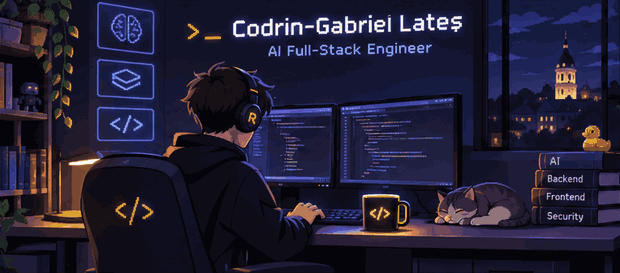

## Hey 👋, I'm Codrin

CS student at Babeș-Bolyai in Cluj-Napoca, building things with code and breaking them (on purpose) for fun.

## ⚡ A Few Quick Facts

- 🔭 I'm currently working on [MirageSoftworks](https://github.com/lates-codrin), a Rust/Luau toolset for Roblox games.
- 🛡️ I spend a lot of time on game security and anti-cheat.
- 🌱 Learning about **developer tools**, **security**, and **automation**.
- 🧩 Most of my projects are in my [repositories](https://github.com/lates-codrin?tab=repositories).
- 💬 Ping me about **AI agents**, **backends**, and **security** stuff.
- 🌐 Fun fact: vorbesc și română. 🇷🇴
- ☕ Fuelled by: *(your fave drink / game / song here)*

## 🚀 Tools I Use

## 📌 Stuff I've Made

- [**MyScheduler**](https://github.com/lates-codrin/MyScheduler): Android app for university timetables
- [**Library Management**](https://github.com/lates-codrin/Library-Management): C# desktop app with AI book recs
- [**Schedule Monitor**](https://github.com/lates-codrin/ScheduleMonitor): tracks timetable changes
- [**Airport Plane Manager**](https://github.com/lates-codrin/airport-plane-manager): small Python app for managing flights

Don't forget to touch grass 🌱
